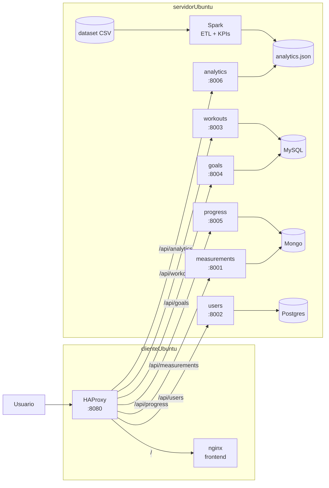
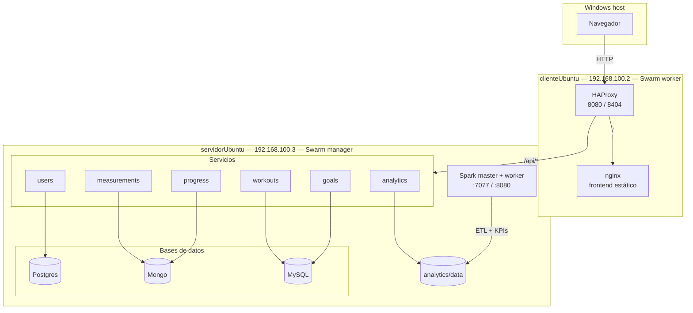
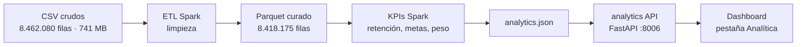

# Diagramas del informe

Estos diagramas están en Mermaid. GitHub los renderiza directamente; para el informe se exportan a
PNG en `report/figuras/`:

- `arquitectura.png` (Figura 1)
- `despliegue.png` (Figura 2)
- `pipeline.png` (Figura 3)

Se pueden renderizar en <https://mermaid.live> o con la extensión de Mermaid de VS Code.

## Figura 1 — Arquitectura de componentes

## Figura 2 — Diagrama de despliegue

## Figura 3 — Pipeline de datos

## Figura 4 — Dashboard

La captura está en `report/figuras/dashboard.jpeg` y se referencia desde el informe. Corresponde a
la pestaña “Analítica” con los 100.000 usuarios y los KPIs calculados por Spark.
