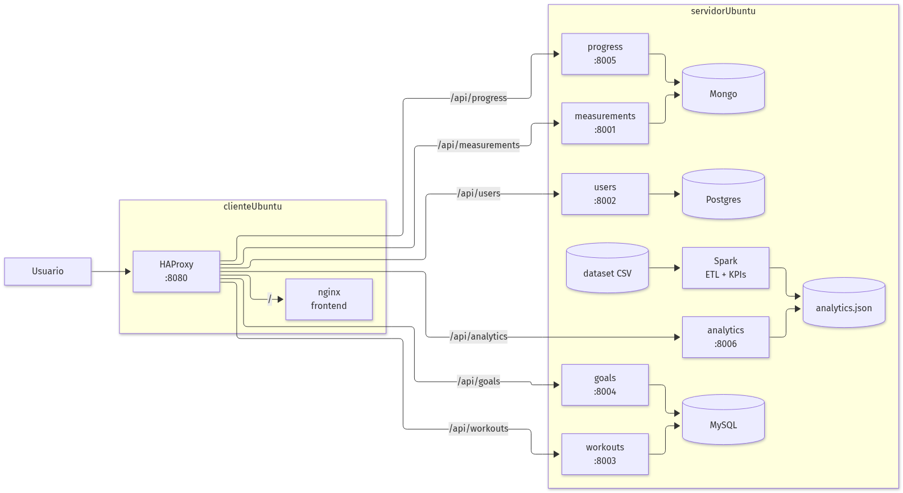
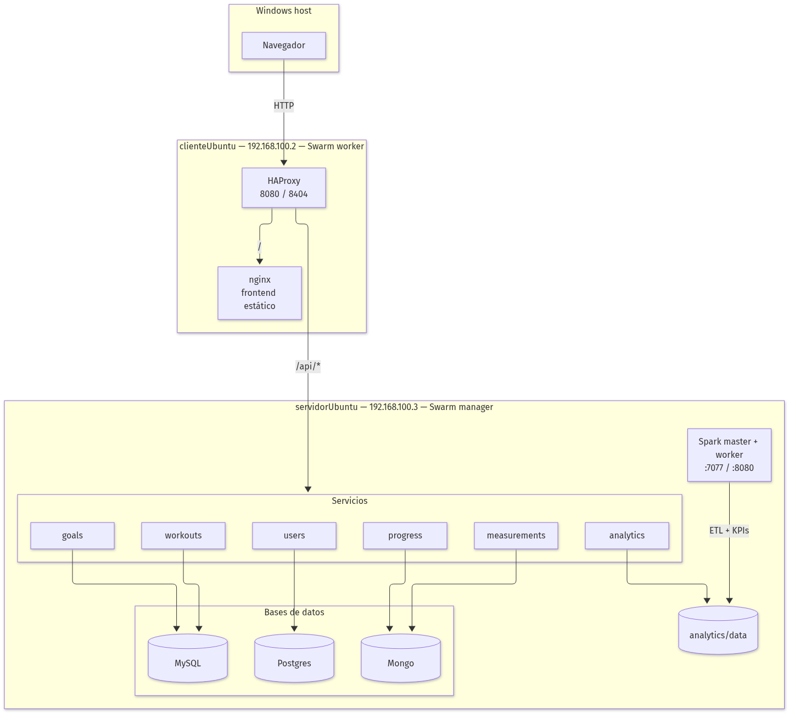
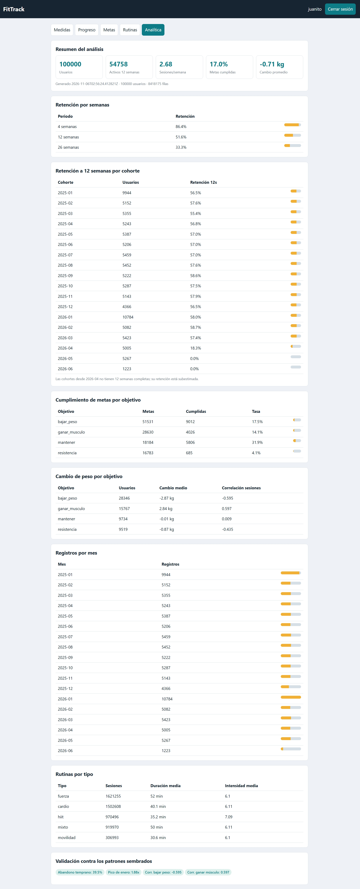

# FitTrack: microservicios en Docker Swarm y análisis distribuido con Apache Spark

**Autores:** Juan Camilo Serrano, Lucio Matías Melendez Rojas, Juan David Ocampo Gutierrez, Nicolás Castro Pacheco, Diego Fernando Asprilla Palacios

**Curso:** Redes e Infraestructura — Proyecto final

**Fecha:** noviembre de 2026

## Resumen

Este trabajo presenta el despliegue de FitTrack, una aplicación de seguimiento físico basada en
microservicios y API REST, sobre un clúster Docker Swarm de dos nodos, y la construcción de un
pipeline de análisis de datos con Apache Spark que alimenta un dashboard. La aplicación se empaquetó
en seis servicios y tres bases de datos, con HAProxy como punto de entrada y balanceo. El pipeline
procesa un dataset sintético de 100.000 usuarios y 8,4 millones de filas, aplica limpieza de
duplicados, fechas y unidades, y calcula KPIs de retención, adherencia, metas y evolución de peso.
Los resultados se publican por una API y se muestran en una pestaña “Analítica”. Las pruebas de carga
muestran una mejora de 1,89× en RPS al pasar de una a tres réplicas, y la validación contra los
patrones sembrados confirma que el análisis recupera las señales del dataset. En la prueba de
failover, matar una de tres réplicas mantuvo el servicio en 99,70 % de éxito y recuperó la tarea en
8 segundos. El trabajo documenta las decisiones, los problemas encontrados y una guía reproducible.

**Palabras clave:** Docker Swarm, microservicios, Apache Spark, análisis distribuido, HAProxy,
dashboard, reproducibilidad.

## 1. Introducción

El módulo de Redes e Infraestructura cubre el empaquetado de aplicaciones, el despliegue en clústeres
de contenedores y el procesamiento de datos a gran escala. El proyecto final integra esas tres
dimensiones sobre una aplicación real: FitTrack, una aplicación de seguimiento físico con servicios
de usuarios, medidas, progreso, rutinas y metas.

El objetivo general es desplegar la aplicación en un clúster de contenedores con escalabilidad y
balanceo, y construir un pipeline de análisis distribuido que genere reportes consumidos por el
dashboard. Los objetivos específicos son:

1. Empaquetar los microservicios y sus bases de datos en imágenes reproducibles.
2. Desplegar el stack en Docker Swarm con HAProxy como entrada y balanceo.
3. Diseñar y ejecutar un ETL con Spark sobre un dataset de gran escala.
4. Calcular KPIs de interés y validarlos contra patrones conocidos.
5. Publicar los resultados por una API y mostrarlos en el dashboard.
6. Medir funcionamiento, escalabilidad y desempeño, y documentar la reproducción.

La contribución principal es una solución completa y reproducible que separa claramente la
aplicación transaccional (microservicios y bases de datos) del procesamiento analítico (Spark y
archivos Parquet/JSON), con evidencia de funcionamiento y de escalado.

## 2. Análisis

### 2.1 Dataset

Se usó **FitTrack-Synth**, un dataset sintético y reproducible generado por el propio equipo. El
profesor autorizó explícitamente su uso. La decisión se justifica por tres razones:

- **Privacidad:** no contiene datos de personas reales.
- **Reproducibilidad:** con la misma semilla (42) y los mismos parámetros se obtiene exactamente el
  mismo dataset.
- **Validación:** el generador siembra patrones conocidos (abandono temprano, pico de enero, efecto
  del entrenamiento sobre el peso) y publica una carpeta `clave_respuestas` para comprobar que el
  análisis los recupera.

El dataset tiene 100.000 usuarios y 8.462.080 filas crudas (741 MB) en cuatro CSV: usuarios, medidas,
metas y rutinas. Cubre 78 semanas, del 2025-01-06 al 2026-07-05. Incluye suciedad controlada:
duplicados exactos, nulos en medidas, fechas en `dd/mm/aaaa`, pesos en libras y pesos absurdos. El
validador del generador ejecutó **24 chequeos OK, 0 con falla**.

La limitación principal es que los datos son sintéticos: los resultados no describen a una población
real, pero sí permiten evaluar el pipeline, la limpieza y la capacidad de recuperar patrones.

### 2.2 Alternativas evaluadas

Se compararon las opciones disponibles para cada dimensión del despliegue. El criterio fue doble: usar
lo que ya estaba disponible en el laboratorio y caber en 3,8 GiB de RAM por nodo, porque el objetivo
del curso es demostrar el funcionamiento, no maximizar la sofisticación de las herramientas.

| Dimensión | Alternativas | Decisión y motivo |
|---|---|---|
| Orquestación | Docker Compose, Swarm, Kubernetes | **Swarm**: ya estaba inicializado en el laboratorio, es nativo de Docker y suficiente para dos nodos. Kubernetes habría exigido más recursos y complejidad. |
| Balanceo | nginx, HAProxy, Traefik | **HAProxy**: `server-template` descubre tareas de Swarm por DNS y permite balanceo round-robin con health checks. |
| Procesamiento | Pandas, Spark, Flink | **Spark**: escalable, tolerante a fallos y disponible en el laboratorio. Pandas no cabe cómodamente en 3,8 GiB para 8,4 M de filas; Flink está orientado a streaming. |
| Almacenamiento analítico | JDBC a Postgres, Parquet + JSON | **Parquet + JSON**: separa el batch de la app, evita un esquema nuevo y permite que el dashboard funcione sin Spark encendido. |
| Visualización | Chart.js/CDN, tablas y barras CSS | **CSS**: sin dependencias externas, funciona offline y se integra con el frontend existente. |

### 2.3 Requisitos

Los requisitos se derivaron del enunciado: despliegue en clúster, escalabilidad, balanceo, pruebas
de desempeño, dataset de gran escala, pipeline de análisis, reportes y dashboard. Se añadieron dos
requisitos no funcionales: reproducibilidad (scripts y README) y operación con recursos limitados
(dos VMs, 3,8 GiB en el servidor).

## 3. Diseño

### 3.1 Arquitectura de componentes



**Figura 1.** Componentes y flujo de una petición.

La aplicación se compone de:

- **Frontend nginx:** sirve el HTML/JS del dashboard. No proxea APIs.
- **HAProxy:** único entrypoint; enruta `/api/<servicio>/` y balancea entre réplicas.
- **users:** registro, login JWT y perfil; Postgres.
- **measurements:** medidas corporales; Mongo.
- **progress:** cálculo de progreso entre fechas; Mongo.
- **workouts:** rutinas; MySQL.
- **goals:** metas y porcentaje de cumplimiento; MySQL.
- **analytics:** API de solo lectura que sirve los KPIs calculados por Spark.
- **postgres, mongo, mysql:** bases de datos con volúmenes `fittrack_*`.

Flujo de una petición: el navegador llama a `http://192.168.100.2:8080/api/...`; HAProxy reescribe
el prefijo y envía la petición al servicio correspondiente. Los servicios validan el JWT contra
`users` y filtran los datos por `user_id`. La pestaña de analítica llama a `/api/analytics/dashboard`,
que devuelve un JSON agregado.

### 3.2 Diagrama de despliegue



**Figura 2.** Despliegue en dos VMs y un clúster Spark.

| Nodo | IP | Rol |
|---|---|---|
| `servidorUbuntu` | 192.168.100.3 | Swarm manager; microservicios, bases de datos, `analytics`, Spark master/worker |
| `clienteUbuntu` | 192.168.100.2 | Swarm worker; nginx y HAProxy |

HAProxy y nginx se fijan al cliente; los servicios con estado y las bases de datos se fijan al
servidor para que los volúmenes y bind mounts estén disponibles. La red overlay de Swarm conecta los
dos nodos.

### 3.3 Pipeline de datos


**Figura 3.** Flujo del dataset al dashboard.

1. **Landing zone:** CSV crudos en `/root/fittrack/dataset/data`.
2. **ETL:** lectura con esquema explícito, limpieza y escritura de Parquet en
   `analytics/curated`.
3. **KPIs:** agregaciones con Spark SQL/DataFrame y escritura de `analytics.json`.
4. **Publicación:** el servicio `analytics` lee el JSON y lo sirve por HTTP.
5. **Dashboard:** la pestaña “Analítica” consume el JSON y renderiza KPIs y tablas.

### 3.4 Reglas de limpieza

El ETL aplica un conjunto fijo de reglas. Cada una responde a una suciedad sembrada a propósito en el
dataset: identificadores repetidos, fechas en dos formatos, pesos en libras, valores imposibles y
metas expresadas en unidades distintas. Solo se descartan filas en dos casos, duplicados y pesos
fuera de rango; los nulos se conservan y las agregaciones los ignoran.

| Problema | Regla |
|---|---|
| Duplicados | Eliminar por `medida_id` y `rutina_id`. |
| Fechas | Aceptar ISO y `dd/mm/aaaa` con `try_to_date`; conservar la primera válida. |
| Unidades | Convertir peso a kg con `unidad_peso` del usuario. |
| Pesos absurdos | Descartar fuera de 30–250 kg. |
| Nulos | Conservar nulos de cintura/brazo/pecho; las agregaciones los ignoran. |
| Metas de peso | Normalizar `valor_inicial` y `valor_objetivo` a kg. |

### 3.5 KPIs y algoritmos

- **Retención:** semanas entre registro y última actividad; porcentaje con actividad a 4, 12 y 26
  semanas, global y por cohorte mensual.
- **Adherencia:** sesiones por semana = rutinas / semanas activas; distribución en cubos.
- **Metas:** tasa de cumplimiento por objetivo y por tercil de ambición
  (`|objetivo/inicial − 1|`).
- **Peso:** primera y última medida válida con al menos 56 días de separación; cambio medio y
  correlación con sesiones/semana.
- **Estacionalidad:** registros y sesiones por mes; pico de enero.
- **Rutinas:** sesiones por tipo y grupo muscular; duración e intensidad medias.

## 4. Implementación

### 4.1 Parte 1: contenedores y Swarm

Cada microservicio tiene su `Dockerfile`. El stack (`docker-stack.yml`) define las imágenes, las
variables de entorno, los volúmenes y las restricciones de placement. Las bases de datos usan
volúmenes nombrados; MySQL carga los esquemas de `workouts` y `goals` en el primer arranque.

HAProxy se construyó con una configuración que usa `server-template` y el resolver DNS de Docker
(`127.0.0.11`). Cada backend admite hasta seis réplicas y balancea en round-robin. Las stats están en
`:8404`.

Un problema encontrado: el nginx del frontend proxeaba `/api/*` a los nombres de servicio y fallaba
al arrancar con `host not found in upstream "users"` cuando los servicios aún no existían. Se corrigió
dejando nginx como servidor estático y HAProxy como único entrypoint de API. La imagen pasó a
`fittrack-nginx:v4`.

### 4.2 Parte 2: Spark y analítica

El ETL (`spark/etl.py`) lee los CSV con esquema explícito, aplica las reglas de limpieza y escribe
Parquet particionado por año. Los KPIs (`spark/analytics.py`) leen el Parquet y generan un JSON con
secciones: dataset, limpieza, KPIs, retención, adherencia, metas, peso, estacionalidad, rutinas,
ciudades y validación.

Se desactivó ANSI (`spark.sql.ansi.enabled=false`) y se usó `try_to_date` para que los valores sucios
no abortaran el job. El servicio `analytics` (FastAPI) lee el JSON por un bind mount de solo lectura y
lo cachea por `mtime`; si Spark vuelve a escribir, la API sirve la versión nueva sin reiniciar.

El frontend añadió la pestaña “Analítica”, con tarjetas de KPIs, tablas y barras CSS. HAProxy añadió
el backend `/api/analytics/*` hacia `analytics:8006`.

### 4.3 Reproducibilidad

El repositorio incluye:

- `README.md` con el paso a paso (stack, dataset, Spark, imágenes y pruebas).
- `spark/run_all.sh` y scripts individuales con memoria configurable.
- `tests/load/load_test.py` sin dependencias externas.
- `.env.example` con las variables del stack.
- `dataset/` con generador, validador y diccionario.

## 5. Pruebas y resultados

### 5.1 Pruebas funcionales

Se probó el flujo completo contra `http://192.168.100.2:8080`:

- registro, login y `/me` (Postgres),
- creación y listado de medidas (Mongo),
- creación y listado de rutinas y metas (MySQL),
- cálculo de progreso (Mongo + llamada a measurements),
- `GET /api/analytics/health`, `/kpis`, `/dashboard` y todas las secciones (200).

### 5.2 Limpieza

De las 8.462.080 filas crudas quedaron 8.418.175 curadas, un descarte neto de 43.905 filas (0,52 %):
40.980 duplicados y 2.925 pesos fuera de rango. El resto del trabajo no fue eliminar filas sino
corregirlas en sitio: 24.728 fechas en formato `dd/mm/aaaa` y 14.659 usuarios con peso en libras. Por
eso el dataset apenas pierde volumen y aun así queda consistente.

| Métrica | Valor |
|---|---|
| Filas crudas | 8.462.080 |
| Medidas curadas | 2.881.725 |
| Rutinas curadas | 5.321.322 |
| Duplicados de medidas | 14.204 |
| Duplicados de rutinas | 26.776 |
| Pesos inválidos | 2.925 |
| Fechas `dd/mm/aaaa` corregidas | 8.703 + 16.025 |
| Usuarios con peso en libras | 14.659 |

### 5.3 KPIs y validación

Los KPIs se calcularon sobre el dataset completo. Para descartar que sean artefactos del cálculo, el
generador deja patrones sembrados y el pipeline los recupera: la segunda tabla contrasta el valor
esperado con el obtenido en los cinco casos. Las correlaciones de peso son las más contundentes:
−0,595 al bajar de peso y +0,597 al ganar músculo, frente a umbrales de −0,3 y +0,3.

| KPI | Valor |
|---|---|
| Usuarios | 100.000 |
| Activos a 12 semanas | 54.758 (54,8 %) |
| Sesiones/semana | 2,68 |
| Metas cumplidas | 16,96 % |
| Cambio medio de peso | −0,71 kg |
| Retención 4 / 12 / 26 semanas | 86,4 % / 51,6 % / 33,3 % |

| Patrón sembrado | Esperado | Obtenido |
|---|---|---|
| Abandono temprano | ~40 % | 39,53 % |
| Pico de enero | ≥ 1,4× | 1,88× |
| Correlación bajar peso | < −0,3 | −0,595 |
| Correlación ganar músculo | > 0,3 | +0,597 |
| Metas ambiciosas (baja → alta) | baja > alta | 29,6 % → 13,9 % → 7,4 % |

### 5.4 Pruebas de carga, escalabilidad y estrés

Prueba de carga: 500 peticiones a `/api/measurements/`, concurrencia 20, desde el host Windows contra
HAProxy.

| Escenario | RPS | p50 | p95 | Errores |
|---|---|---|---|---|
| 1 réplica | 38,15 | 513,09 ms | 654,58 ms | 0 |
| 3 réplicas en un nodo | **72,05** | **272,48 ms** | **411,70 ms** | 0 |
| 3 réplicas en dos nodos | 53,31–54,22 | 278–304 ms | 839–871 ms | 0 |

El escalado en un mismo nodo mejora **1,89×** en RPS, −47 % en p50 y −37 % en p95. La primera
medición con tres réplicas dio p95 de 3.485 ms porque el worker de Spark seguía vivo y el servidor
usaba 913 MiB de swap; al detenerlo, la comparación fue limpia.

La prueba multi-nodo se hizo con `users` repartido 2+1 y `measurements` 1+2 entre `servidorUbuntu` y
`clienteUbuntu`. La distribución funciona (0 errores), pero el throughput baja a 53–54 RPS: la red
overlay y el worker de 2 cores pesan más que el beneficio de repartir en este laboratorio.

Prueba de estrés con `hey`, 30 segundos por nivel, contra `/api/measurements/`:

| Conexiones | RPS | p50 | p95 | Timeouts |
|---|---|---|---|---|
| 50 | 59,17 | 605 ms | 2.237 ms | 0 |
| 100 | 58,57 | 726 ms | 4.427 ms | 152 |
| 200 | 61,05 | 1.575 ms | 4.567 ms | 797 |

El RPS de `hey` cuenta solicitudes intentadas. El goodput baja a 53,6 RPS con 100 conexiones y a
37,2 RPS con 200, por los timeouts de cliente a 5 s. La meseta de ~60 RPS y la aparición de timeouts
desde 100 conexiones marcan el punto de saturación del laboratorio. Después del estrés, HAProxy
volvió a mostrar todos los backends en `UP`.

### 5.5 Tolerancia a fallos

Prueba de failover: 8.000 peticiones a `/api/users/me`, concurrencia 20, con `users` en 3 réplicas
(1 en el servidor + 2 en el cliente). A mitad de la prueba se mató el contenedor de una tarea con
`docker kill`, sin previo aviso a Swarm. Se corrió además un control idéntico sin matar nada.

| Escenario | Éxito | Errores | RPS | p95 |
|---|---|---|---|---|
| Control (sin fallo) | 100 % | 0 | 113,11 | 400,38 ms |
| Con failover | **99,70 %** | 24 (0,30 %) | 97,61 | 400,66 ms |

Los 24 errores se concentran en la ventana de 8 segundos del failover, no se reparten por la prueba:
22 son conexiones cortadas (código 0, peticiones ya enviadas al contenedor que murió) y 2 son `502`
de HAProxy. Sobre las ~780 peticiones que pasaron en esa ventana, falló cerca del 3 %; el 99,7 % del
total no notó nada. El p95 quedó igual que en el control (400,66 vs 400,38 ms): las dos réplicas
sobrevivientes absorbieron el tráfico sin degradar la latencia.

La línea de tiempo de HAProxy, muestreada cada segundo, da 8 segundos de recuperación:

```
16:02:10  users1=MAINT (resolution)   ← muere la tarea, desaparece del DNS del servicio
16:02:16  users1=UP 1/3               ← tarea nueva arrancando, health check parcial
16:02:18  users1=UP                   ← recuperado
```

El `502` se explica por la configuración: HAProxy usa `server-template` con resolución DNS de Docker
(`resolvers docker`), no health checks HTTP activos. Cuando el contenedor muere, su IP desaparece del
DNS y HAProxy la retira en el siguiente ciclo; en ese hueco de milisegundos todavía puede mandar una
petición a la IP muerta. Con `option redispatch` y `retries` el cliente no lo vería.

La prueba demuestra tolerancia a fallos **a nivel de tarea**. Si cae el nodo completo o la base de
datos, el servicio no se recupera solo: las bases son instancias únicas en `role=server`.

### 5.6 Dashboard



**Figura 4.** Pestaña “Analítica” con KPIs, retención, metas, peso, estacionalidad y validación.

### 5.7 Discusión

- **Fortalezas:** solución completa, reproducible y con evidencia; separación clara entre app y
  analítica; validación contra patrones conocidos; documentación de problemas y decisiones.
- **Limitaciones:** dataset sintético; un solo worker de Spark; las bases son instancias únicas; el
  failover probado es de tarea, no de nodo ni de base; los KPIs son batch, no tiempo real; la
  distribución multi-nodo está probada, pero el throughput no mejora por la red overlay y el worker
  de 2 cores; el servidor compite con el stack.
- **Riesgos:** memoria y swap al correr Spark con el stack; tareas huérfanas de intentos anteriores;
  la rama `main` del repo no refleja la versión Docker.

## 6. Conclusiones y trabajo futuro

Se desplegó FitTrack en Docker Swarm con balanceo, se construyó un pipeline de Spark para 8,4 M de
filas y se publicaron los resultados en el dashboard. Las pruebas funcionales, de carga, de
distribución multi-nodo, de estrés y de failover confirman que la solución cumple los objetivos. El
escalado a tres réplicas en un nodo casi duplicó el throughput (72,05 RPS, 0 errores); la
distribución entre los dos nodos se demostró con 2+1 y 1+2 réplicas, aunque el rendimiento bajó a
53–54 RPS por la red overlay y el worker de 2 cores. El estrés marcó una meseta de ~60 RPS y timeouts
desde 100 conexiones. En el failover, matar una de tres tareas dejó el servicio en 99,70 % de éxito,
con el p95 intacto y recuperación en 8 segundos.

Trabajo futuro:

1. **Spark de dos nodos** con un filesystem compartido (NFS) o HDFS para que el Parquet no quede
   repartido entre nodos; medir 1 vs 2 workers.
2. **Replicar las bases de datos** (Postgres/MySQL/Mongo) para eliminar el punto único de fallo;
   hoy el failover es a nivel de tarea, no de base.
3. **`option redispatch` y `retries` en HAProxy** para que el cliente no reciba los `502` del hueco
   entre la muerte de la tarea y la retirada de su IP del DNS.
4. **Streaming** con Structured Streaming para KPIs en tiempo real.
5. **Observabilidad:** métricas de HAProxy, Prometheus/Grafana y alertas.
6. **CI/CD:** construir y publicar imágenes automáticamente, con pruebas de humo.
7. **Datos reales** anonimizados, si el profesor lo permite, para contrastar los hallazgos.

## Referencias

1. Docker Inc., *Docker Swarm mode overview*. https://docs.docker.com/engine/swarm/
2. HAProxy Technologies, *HAProxy Configuration Manual*. https://docs.haproxy.org/
3. Apache Software Foundation, *Spark SQL, DataFrames and Datasets Guide*.
   https://spark.apache.org/docs/latest/sql-programming-guide.html
4. Apache Software Foundation, *Structured Streaming Programming Guide*.
   https://spark.apache.org/docs/latest/structured-streaming-programming-guide.html
5. FastAPI, *FastAPI documentation*. https://fastapi.tiangolo.com/
6. FitTrack, repositorio del proyecto, rama `proyecto-final`.
   https://github.com/nicocpxmd/fittrack
7. FitTrack-Synth, generador y validador del dataset, carpeta `dataset/`.
8. IEEE, *IEEE Conference Template*. https://www.ieee.org/conferences/publishing/templates.html
