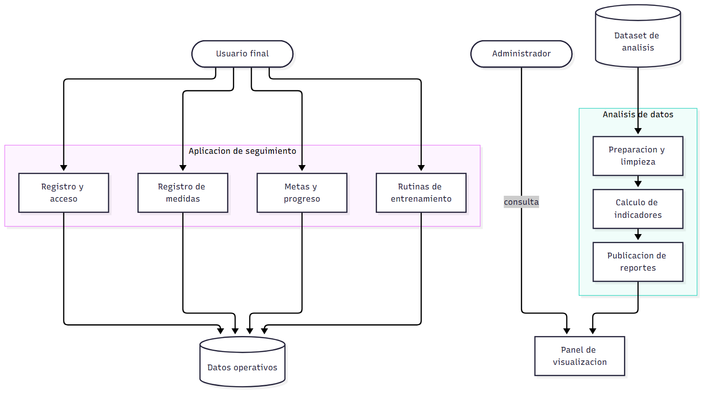

<!-- _class: portada -->

<!--
BLOQUE 1 · Juan Camilo · 0:00 - 3:00
FASES: Introducción y Análisis
-->

# FitTrack
## Microservicios, Spark y analítica sobre 8,4 millones de filas

Juan Camilo Serrano · Lucio Matías Melendez Rojas · Juan David Ocampo Gutierrez · Nicolás Castro Pacheco · Diego Fernando Asprilla Palacios

Curso de Redes e Infraestructura
Universidad Autónoma de Occidente — 20 de noviembre de 2026

<!--
0:00 - 0:15
Buenos días. Somos el equipo de FitTrack. En 15 minutos les mostramos el proyecto
en el mismo orden del informe: introducción, análisis, diseño, implementación,
pruebas y conclusiones.
-->

---

Introducción

## El problema

- Una aplicación de seguimiento físico genera datos todos los días: medidas, metas y rutinas
- El usuario quiere saber si progresa; el negocio quiere saber qué funciona
- Calcular eso dentro de la aplicación la volvería lenta y frágil
- De ahí la separación: **la app opera, el análisis responde**

<!--
0:15 - 1:00
El problema es simple: la aplicación acumula datos, pero las preguntas interesantes
—quién progresa, qué metas se cumplen, qué retención hay— no se contestan en el camino
de una petición. Si las metiéramos en la app, cada consulta competiría con el registro
de una medida. Por eso separamos dos planos desde el diseño.
-->

---

Introducción

## Lo que pedía el proyecto

| Requerimiento | Cómo se cumplió |
|---|---|
| Aplicación en contenedores | 6 microservicios + 3 bases, imágenes propias |
| Clúster con balanceo | Docker Swarm, 2 nodos, HAProxy |
| Escalabilidad medida | 1 → 3 réplicas: **38 → 72 RPS** |
| Procesamiento a gran escala | Spark sobre **8,46 M de filas** |
| Reportes en la aplicación | API + pestaña Analítica |
| Reproducibilidad | README, tag y clon limpio verificado |

<!--
1:00 - 1:50
Estos seis puntos son el enunciado. Ninguno quedó a medias: cada uno tiene una
medición o una prueba detrás. Y hay un séptimo requisito que salió en la revisión:
que la analítica solo la vea un administrador.
-->

---

Análisis

## El dataset es sintético, y eso fue una decisión

- **100.000 usuarios**, 78 semanas (2025-01 a 2026-07), **8.462.080 filas** en 4 CSV
- Generado por código con **semilla 42**: se reproduce idéntico
- Autorizado por el profesor: no hay datos de personas reales
- Trae **suciedad controlada**: duplicados, fechas `dd/mm/aaaa`, libras, pesos imposibles
- Siembra **patrones conocidos** para poder validar el análisis

El validador del generador ejecuta 24 chequeos: 24 OK, 0 fallas.

<!--
1:50 - 3:00
No usamos datos reales por privacidad, y el dataset no es ruido: es un simulador.
Cada usuario tiene un perfil oculto -constancia, sensibilidad al entrenamiento, si abandona-
y de ahí se simulan sus sesiones y su peso semana a semana.
Las metas se crean mirando la trayectoria real, así que el cumplimiento emerge del comportamiento.
Y ensuciamos a propósito para que la limpieza signifique algo.
-->

---

<!--
BLOQUE 2 · Diego · 3:00 - 6:00
FASE: Diseño
-->

Diseño

## Arquitectura: dos planos separados

La aplicación opera; el análisis responde por lotes. Ninguno escribe en el plano del otro.

<!--
3:00 - 3:50
Esta es la arquitectura lógica, sin tecnologías todavía.
Arriba, el usuario final con la aplicación y sus datos operativos.
A la derecha, el dataset de análisis que entra a un proceso por lotes y termina en un panel
que solo ve el administrador. Cada plano puede fallar sin tumbar al otro.
-->

---

Diseño

## Componentes: servicios, interfaces y dependencias

Cada servicio valida el token contra el servicio de usuarios; solo la analítica exige rol de administrador.

<!--
3:50 - 4:35
Un nivel más abajo aparecen las tecnologías. Cada servicio es REST y se consume por HAProxy,
el único entrypoint de /api. users valida el token y los demás lo consultan antes de responder:
la autenticación no se repite en cinco servicios.
-->

---

Diseño

## Despliegue: dos VMs y un clúster Spark

nginx y HAProxy en el cliente; servicios y bases en el servidor; Spark trabaja por lotes.

<!--
4:35 - 5:20
El despliegue físico: nginx y HAProxy en el cliente, servicios y bases en el servidor,
con volúmenes para las tres bases. Spark corre aparte y deja el JSON que sirve la API.
Los servicios sin estado se reparten entre los dos nodos.
-->

---

Diseño

## Pipeline de datos

**El cálculo ocurre dos veces, en batch:** una para limpiar y otra para agregar. Después, la app solo lee un archivo.

<!--
5:20 - 6:00
El diseño del análisis: CSV con esquema explícito, limpieza, Parquet particionado por año,
KPIs y un JSON. La app no calcula nada: monta ese archivo y lo sirve.
Con esto cierro diseño y paso a implementación.
-->

---

<!--
BLOQUE 3 · Juan David · 6:00 - 9:00
FASES: Implementación y Pruebas
-->

Implementación

## Swarm: réplicas repartidas y balanceo

- Dos nodos: `servidorUbuntu` (manager) y `clienteUbuntu` (worker)
- `users` y `measurements`: **3 réplicas** cada uno, repartidas 2+1 y 1+2
- HAProxy descubre las tareas por **DNS de Docker** y balancea en round-robin
- **7 backends** en `UP`; se comprueba en `:8404`

Las réplicas no están fijas al servidor: `max_replicas_per_node: 2` y dispersión por rol.

<!--
6:00 - 6:50
La implementación no fija todo al servidor. Con tres réplicas y un límite de dos por nodo,
Swarm las reparte entre las dos máquinas. Cuando se mueve una tarea, HAProxy la encuentra
sola por DNS: no hay IPs escritas a mano.
-->

---

Pruebas

## Carga: 500 peticiones, concurrencia 20

| Escenario | RPS | p95 | Errores |
|---|---|---|---|
| 1 réplica | 38,15 | 655 ms | 0 |
| **3 réplicas, un nodo** | **72,05** | **412 ms** | 0 |
| 3 réplicas, dos nodos | 53,31 | 871 ms | 0 |

**1,89× más rendimiento** y 37 % menos latencia al escalar en un nodo.

Medido con `tests/load/load_test.py`, sin dependencias externas.

<!--
6:50 - 7:30
Con una réplica, 38 peticiones por segundo; con tres en el mismo nodo, 72. Casi el doble,
y el p95 baja de 655 a 412 milisegundos. El tercer caso es multi-nodo: funciona sin errores
pero rinde menos, y eso lo explico en las conclusiones porque es un hallazgo, no un fallo.
-->

---

Pruebas

## Estrés: dónde se rompe el laboratorio

| Conexiones | RPS | p95 | Timeouts |
|---|---|---|---|
| 50 | 59,2 | 2.237 ms | 0 |
| 100 | 58,6 | 4.427 ms | 152 |
| 200 | 61,1 | 4.567 ms | 797 |

**Meseta de ~60 RPS.** Desde 100 conexiones aparecen timeouts de cliente.

El goodput baja a 53,6 y 37,2 RPS: no todo lo que se intenta se completa.

<!--
7:30 - 8:10
Con hey subimos la presión. El sistema se queda en unos 60 RPS: ese es el techo del
laboratorio, medido. Desde 100 conexiones el cliente empieza a cortar por timeout a los 5 segundos.
-->

---

Pruebas

## Failover: matar una réplica en plena carga

| Escenario | Éxito | Errores | p95 |
|---|---|---|---|
| Control | 100 % | 0 | 400 ms |
| **Con `docker kill`** | **99,70 %** | 24 | 401 ms |

Los 24 errores caen en los **8 segundos** de recuperación:
22 conexiones cortadas y 2 respuestas `502`.

`MAINT` → `UP 1/3` → `UP`. Swarm repone la tarea y HAProxy la vuelve a incluir.

<!--
8:10 - 9:00
La prueba más elocuente: matamos una de las tres réplicas con carga encima.
99,70 por ciento de éxito, el p95 no se movió y Swarm repuso la tarea en 8 segundos.
Los 2 errores 502 son el hueco de milisegundos antes de que HAProxy sacara la IP muerta.
Con esto cierro pruebas de desempeño.
-->

---

<!--
BLOQUE 4 · Nicolás · 9:00 - 12:00 (+15 s de apertura del video)
FASES: Implementación y Pruebas de la analítica
-->

Implementación

## La analítica solo la ve un administrador

| Petición | Token | Código |
|---|---|---|
| `/api/analytics/health` | sin token | **200** |
| `/api/analytics/dashboard` | sin token | **401** |
| `/api/analytics/dashboard` | usuario normal | **403** |
| `/api/analytics/dashboard` | administrador | **200** |

La restricción está en el **servicio**, no en la interfaz: ocultar la pestaña es solo comodidad.

<!--
9:00 - 9:45
Este requisito salió de la revisión con el profesor. Implementamos roles en la base y el
servicio de analítica valida el token y el rol en cada petición. La validación está en el
servidor: si alguien llama la API sin rol, recibe 403 aunque la pestaña no exista.
-->

---

Implementación

## ETL, KPIs y publicación

- **ETL**: CSV con esquema explícito, limpieza y Parquet particionado por año
- **KPIs**: agregaciones con Spark SQL sobre el Parquet
- **Salida**: un `analytics.json` de 12 secciones
- **Publicación**: la API monta el archivo y lo cachea por `mtime`

Si Spark vuelve a correr, la API sirve la versión nueva sin reiniciar.

<!--
9:45 - 10:35
El ETL no infiere el esquema: lo declara, para que una fecha mal formada no rompa el job.
La limpieza corrige en sitio -fechas, libras, duplicados- y solo descarta lo imposible.
Los KPIs salen de Spark SQL y quedan en un solo JSON que la API sirve sin tocar Spark ni las bases.
-->

---

Pruebas

## Los KPIs reproducen los patrones sembrados

| KPI | Valor |
|---|---|
| Usuarios / activos a 12 semanas | 100.000 / 54.758 (54,8 %) |
| Sesiones por semana | 2,68 |
| Metas cumplidas | 16,96 % |
| Cambio medio de peso | −0,71 kg |

**Validación:** abandono 39,53 % (≈40 %), enero 1,88×, correlaciones −0,595 y +0,597.

El análisis recupera lo que el generador sembró: no son números inventados.

<!--
10:35 - 11:20
Estos son los indicadores del dataset completo. Lo importante es la segunda línea: el generador
dejó patrones y el análisis los recupera. Eso separa un dashboard de un cálculo: los números
se pueden contrastar contra la realidad sembrada.

12:00 - 12:15 (apertura del video)
Con esto termino mi parte. Para mostrar que todo esto funciona, un recorrido de dos minutos
por la aplicación. [SE ABRE EL VIDEO FUERA DEL PDF]
-->

---

<!--
BLOQUE 5 · Lucio · 14:20 - 17:20
FASE: Conclusiones y referencias
-->

Conclusiones

## Qué quedó demostrado

  
<strong>72</strong>RPS con 3 réplicas, 0 errores

  
<strong>99,70 %</strong>de éxito al perder una réplica

  
<strong>8 s</strong>de recuperación

  
<strong>8,46 M</strong>filas procesadas con Spark

- **El análisis es verificable:** los KPIs reproducen los patrones sembrados
- **La separación de planos paga:** el dashboard sigue en pie con Spark apagado
- **La reproducibilidad se probó:** un clon limpio levanta el sistema sin las VMs del laboratorio

<!--
14:05 - 14:20 (cierre del video, con el reproductor en pantalla)
Eso es el sistema completo: el usuario opera la aplicación, el administrador ve la analítica
y el balanceo reparte la carga entre las réplicas.

14:20 - 15:30
En una frase: no solo está desplegado, está medido.
Estas cuatro cifras resumen el proyecto: 72 peticiones por segundo con tres réplicas y cero errores;
99,70 por ciento de éxito cuando matamos una réplica; ocho segundos para reponerla; y 8,46 millones
de filas procesadas con Spark.
Y algo que valoramos: cualquiera puede clonar el repositorio y verlo funcionar.
-->

---

Conclusiones

## Limitaciones y trabajo futuro

**Limitaciones**

- Un solo worker de Spark: el segundo nodo exige NFS o HDFS para compartir el Parquet
- Bases de instancia única: el failover es de tarea, no de base
- El multi-nodo rinde menos que tres réplicas en un nodo: pesa la red overlay

**Trabajo futuro**

- Worker de Spark en el cliente y réplica de las bases
- Observabilidad con Prometheus y alertas
- CI/CD para construir y publicar las imágenes

<!--
15:30 - 16:40
Preferimos decir nosotros lo que falta.
El clúster de Spark tiene un worker en el mismo nodo: para usar el segundo hace falta almacenamiento
compartido. Las bases son únicas, así que si cae la base el servicio no se recupera solo. Y repartir
entre dos nodos rinde menos que tres réplicas en uno.
Como trabajo futuro: el worker en el cliente, réplicas de las bases, observabilidad y CI/CD.
-->

---

Referencias

## Referencias

1. Docker Inc., *Docker Swarm mode overview*. docs.docker.com/engine/swarm
2. HAProxy Technologies, *HAProxy Configuration Manual*. docs.haproxy.org
3. Apache Software Foundation, *Spark SQL, DataFrames and Datasets Guide*. spark.apache.org
4. FastAPI, *FastAPI documentation*. fastapi.tiangolo.com
5. FitTrack, repositorio del proyecto, tag `v4.0-proyecto-final`. github.com/nicocpxmd/fittrack

<!--
16:40 - 17:10
Estas son las fuentes principales; el repositorio tiene el README y el tag de entrega.

17:10 - 17:20
Cerramos: seis requerimientos, dos planos bien separados y evidencia medible.
Quedamos atentos a las preguntas.
-->
