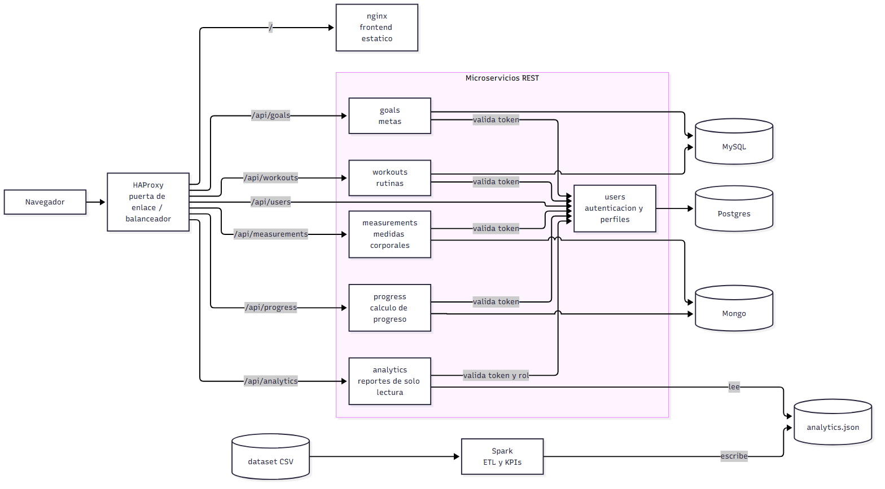
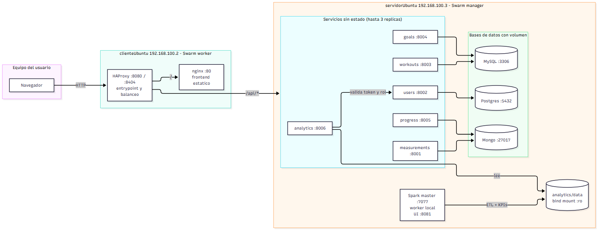
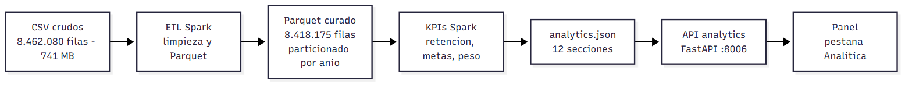
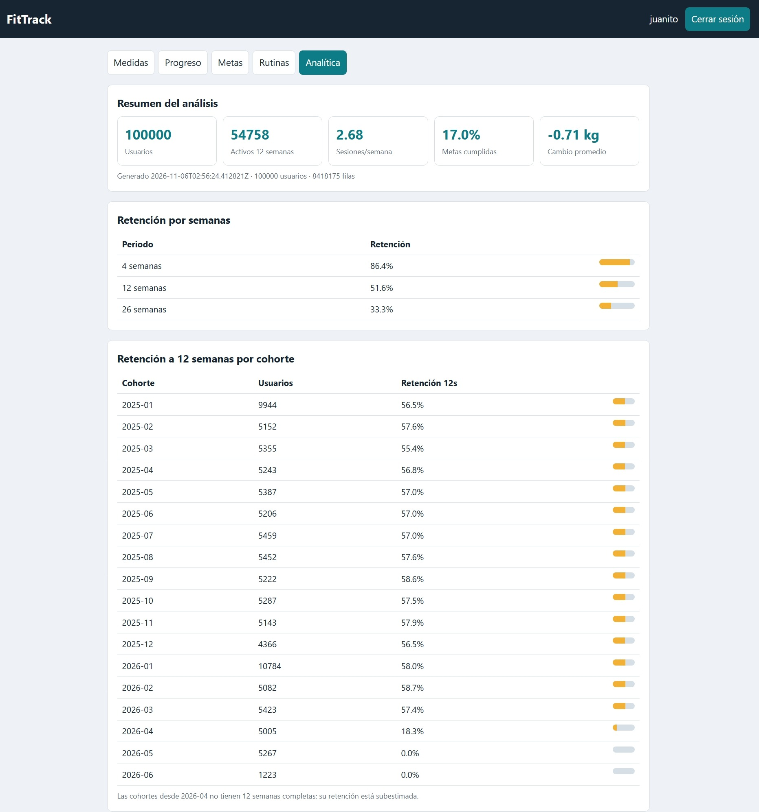

<!--
BLOQUE 1 - Problema y datos (3:00)
-->

# FitTrack
## Microservicios, Spark y analítica sobre 8,4 millones de filas

**Curso de Redes e Infraestructura**
Universidad Autónoma de Occidente — 20 de noviembre de 2026

<!--
0:00 - 0:20
Buenos días. Somos el equipo de FitTrack. En 15 minutos les mostramos las tres fases
del proyecto: la aplicación en contenedores, el procesamiento con Spark y los resultados.
La entrega está congelada en el tag v4.0 del repositorio.
-->

---

## Lo que pedía el proyecto

| Requerimiento | Cómo se cumplió |
|---|---|
| Aplicación en contenedores | 6 microservicios + 3 bases, imágenes propias |
| Clúster con balanceo | Docker Swarm, 2 nodos, HAProxy |
| Escalabilidad medida | 1 → 3 réplicas: **38 → 72 RPS** |
| Procesamiento a gran escala | Spark sobre **8,46 M de filas** |
| Reportes en la aplicación | API + pestaña Analítica |
| Reproducibilidad | README, tag y clon limpio verificado |

<!--
0:20 - 1:20
Todo el proyecto se organizó alrededor de estos seis puntos del enunciado.
No sobra ninguno y ninguno quedó a medias: cada uno tiene una medición o una prueba.
-->

---

## El dataset es sintético, y eso fue una decisión

- **100.000 usuarios**, 78 semanas (2025-01 a 2026-07), **8.462.080 filas** en 4 CSV
- Generado por código con **semilla 42**: se reproduce idéntico
- Autorizado por el profesor: no hay datos de personas reales
- Trae **suciedad controlada**: duplicados, fechas `dd/mm/aaaa`, libras, pesos imposibles
- Siembra **patrones conocidos** para poder validar el análisis

El validador del generador ejecuta 24 chequeos: 24 OK, 0 fallas.

<!--
1:20 - 3:00
No usamos datos reales por privacidad, y el dataset no es ruido: es un simulador.
Cada usuario tiene un perfil oculto -constancia, sensibilidad al entrenamiento, si abandona-
y a partir de eso se simulan sus sesiones y su peso semana a semana.
Las metas se crean mirando la trayectoria real, así que el cumplimiento emerge del comportamiento.
Y ensuciamos a propósito para que la limpieza signifique algo.
-->

---

<!--
BLOQUE 2 - Arquitectura y despliegue (3:00)
-->

## Arquitectura: dos planos separados

El usuario usa la aplicación; el administrador consulta los indicadores.
El análisis **no escribe** en las bases operativas y la aplicación **no calcula** indicadores.

<!--
3:00 - 4:00
Esta es la arquitectura lógica, sin tecnologías todavía.
Arriba, el usuario final con la aplicación de seguimiento y sus datos operativos.
A la derecha, el dataset de análisis que entra a un proceso por lotes y termina en un panel
que solo ve el administrador.
La separación es deliberada: cada plano puede fallar sin tumbar al otro.
-->

---

## Componentes: servicios, interfaces y dependencias

Cada servicio valida el token contra `users`; solo `analytics` exige rol de administrador.

<!--
4:00 - 4:30
Un nivel más abajo aparecen las tecnologías. Cada servicio es REST y se consume por HAProxy,
que es el único entrypoint de /api.
users valida el token y cada servicio lo consulta antes de responder: la autenticación no se repite.
-->

---

## Despliegue: dos VMs y un clúster Spark

nginx y HAProxy en el cliente; servicios y bases en el servidor; Spark trabaja por lotes.

<!--
4:30 - 5:00
A la derecha, el despliegue físico: nginx y HAProxy en el cliente, servicios y bases en el servidor,
con volúmenes para las tres bases. Spark corre aparte y deja el JSON que sirve la API.
-->

---

## Swarm: réplicas repartidas y balanceo

- Dos nodos: `servidorUbuntu` (manager) y `clienteUbuntu` (worker)
- `users` y `measurements`: **3 réplicas** cada uno, repartidas 2+1 y 1+2
- HAProxy descubre las tareas por **DNS de Docker** y balancea en round-robin
- **7 backends** en `UP`; se comprueba en `:8404`

Las réplicas no están fijas al servidor: `max_replicas_per_node: 2` y dispersión por rol.

<!--
5:00 - 6:00
Para demostrar distribución, no solo balanceo, quitamos la restricción que fijaba todo al servidor.
Con tres réplicas y un límite de dos por nodo, Swarm las reparte entre las dos máquinas.
Cuando se mueve una tarea, HAProxy la encuentra sola: no hay IPs escritas a mano.
-->

---

<!--
BLOQUE 3 - Rendimiento y tolerancia (3:00)
-->

## Pruebas de carga: 500 peticiones, concurrencia 20

| Escenario | RPS | p95 | Errores |
|---|---|---|---|
| 1 réplica | 38,15 | 655 ms | 0 |
| **3 réplicas, un nodo** | **72,05** | **412 ms** | 0 |
| 3 réplicas, dos nodos | 53,31 | 871 ms | 0 |

**1,89× más rendimiento** y 37 % menos latencia al escalar en un nodo.

Medido con `tests/load/load_test.py`, sin dependencias externas.

<!--
6:00 - 7:10
Aquí está la evidencia del escalado. Con una réplica, 38 peticiones por segundo; con tres en el
mismo nodo, 72. Casi el doble, y la latencia del percentil 95 baja de 655 a 412 milisegundos.
El tercer caso es el multi-nodo: funciona sin errores, pero rinde menos. Eso lo explico después
porque es una conclusión, no un fallo.
-->

---

## Estrés: dónde se rompe el laboratorio

| Conexiones | RPS | p95 | Timeouts |
|---|---|---|---|
| 50 | 59,2 | 2.237 ms | 0 |
| 100 | 58,6 | 4.427 ms | 152 |
| 200 | 61,1 | 4.567 ms | 797 |

**Meseta de ~60 RPS.** Desde 100 conexiones aparecen timeouts de cliente.

El goodput baja a 53,6 y 37,2 RPS: no todo lo que se intenta se completa.

<!--
7:10 - 8:00
Con hey subimos la presión. El sistema se queda en unos 60 RPS y no sube más: eso es el techo
del laboratorio, medido, no supuesto. A partir de 100 conexiones simultáneas el cliente empieza
a cortar por timeout a los cinco segundos.
-->

---

## Failover: matar una réplica en plena carga

| Escenario | Éxito | Errores | p95 |
|---|---|---|---|
| Control | 100 % | 0 | 400 ms |
| **Con `docker kill`** | **99,70 %** | 24 | 401 ms |

Los 24 errores caen en los **8 segundos** de recuperación:
22 conexiones cortadas y 2 respuestas `502`.

`MAINT` → `UP 1/3` → `UP`. Swarm repone la tarea y HAProxy la vuelve a incluir.

<!--
8:00 - 9:00
La prueba que más dice del sistema: matamos una de las tres réplicas mientras había carga.
El servicio quedó en 99,70 por ciento de éxito, el percentil 95 no se movió y Swarm repuso la
tarea en ocho segundos. Dos de esos errores fueron 502 en el hueco de milisegundos antes de que
HAProxy sacara la IP muerta del balanceo.
-->

---

<!--
BLOQUE 4 - Analítica (3:00)
-->

## La analítica solo la ve un administrador

| Petición | Token | Código |
|---|---|---|
| `/api/analytics/health` | sin token | **200** |
| `/api/analytics/dashboard` | sin token | **401** |
| `/api/analytics/dashboard` | usuario normal | **403** |
| `/api/analytics/dashboard` | administrador | **200** |

La restricción está en el **servicio**, no en la interfaz: ocultar la pestaña es solo comodidad.

<!--
9:00 - 9:50
Este requisito salió de la revisión con el profesor: los indicadores agregados no los puede ver
cualquier usuario. Implementamos roles en la base y el servicio de analítica valida el token y el rol
en cada petición. Insistimos en que la validación está en el servidor: si alguien pide la API
directamente sin rol, recibe 403.
-->

---

## El pipeline: del CSV al dashboard

**El cálculo ocurre dos veces, en batch:** una para limpiar y otra para agregar. Después, la app solo lee un archivo.

<!--
9:50 - 10:50
El trabajo analítico no ocurre en la aplicación. Spark lee los CSV con esquema explícito, limpia,
escribe Parquet particionado por año y luego calcula los KPIs en un único JSON.
El servicio de analítica monta ese archivo y lo sirve; si Spark vuelve a correr, la API toma la
versión nueva sin reiniciar.
-->

---

## KPIs y validación

| KPI | Valor |
|---|---|
| Usuarios / activos a 12 semanas | 100.000 / 54.758 (54,8 %) |
| Sesiones por semana | 2,68 |
| Metas cumplidas | 16,96 % |
| Cambio medio de peso | −0,71 kg |

**Contra los patrones sembrados:** abandono 39,53 % (≈40 %), enero 1,88×, correlaciones −0,595 y +0,597.

El análisis recupera lo que el generador sembró: no son números inventados.

<!--
10:50 - 11:50
Estos son los indicadores del dataset completo. Lo importante es la segunda línea: el generador
dejó patrones conocidos y el análisis los recupera. Eso es lo que separa un dashboard de un cálculo:
los números se pueden contrastar contra la realidad sembrada.
-->

---

<!--
VIDEO - 2:00 (lo abre el bloque 4 y lo cierra el bloque 5)
-->

## Demostración

Lo que van a ver: registro, las tres bases, balanceo y la pestaña Analítica con roles.

<!--
11:50 - 12:00 (introducción, 10 s)
Para mostrar que todo esto funciona, un recorrido de dos minutos por la aplicación.

[SE REPRODUCE EL VIDEO - 2:00]

12:00 - 12:20 (cierre, 20 s)
Eso es el sistema completo: un usuario normal opera la app, el administrador ve la analítica
y el balanceo reparte la carga entre las réplicas. Todo corriendo en el laboratorio.
-->

---

<!--
BLOQUE 5 - Cierre (3:00)
-->

## Conclusiones

- **Funciona y está medido:** 72 RPS con tres réplicas, 0 errores; failover en 8 s con 99,70 % de éxito
- **El análisis es verificable:** los KPIs reproducen los patrones sembrados
- **La separación de planos paga:** el dashboard sigue en pie con Spark apagado
- **La reproducibilidad se probó:** un clon limpio levanta el sistema sin las VMs del laboratorio

<!--
12:20 - 13:40
En una frase: no solo está desplegado, está medido. El escalado casi duplica el rendimiento,
el sistema tolera la caída de una tarea y el análisis se puede contrastar.
Y algo que valoramos mucho: cualquiera puede clonar el repositorio y verlo funcionar.
-->

---

## Limitaciones y trabajo futuro

- **Un solo worker de Spark**: el segundo nodo exige NFS o HDFS para compartir el Parquet
- **Bases de instancia única**: el failover es de tarea, no de base
- **Multi-nodo rinde menos** que tres réplicas en un nodo: pesa la red overlay
- **Siguiente paso**: worker en el cliente, réplica de bases y observabilidad con Prometheus

<!--
13:40 - 14:40
Preferimos decirlo antes de que lo pregunten. El clúster de Spark tiene un worker en el mismo nodo:
para usar el segundo hace falta almacenamiento compartido, porque con file:// el Parquet queda
repartido. Y las bases son únicas: si cae la base, el servicio no se recupera solo.
-->

---

# Gracias

**Preguntas**

github.com/nicocpxmd/fittrack · tag v4.0-proyecto-final

<!--
14:40 - 15:00
Con eso cerramos. Quedamos atentos a las preguntas.
-->
